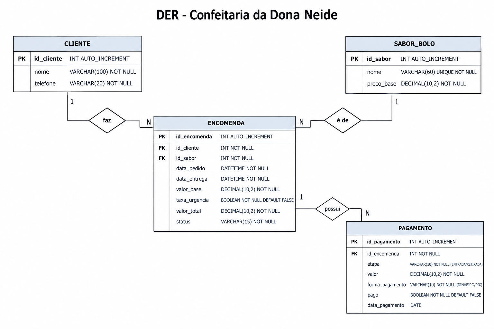

O objetivo é criar um sistema para a Dona Neide organizar as encomendas de bolos da confeitaria. O sistema permitirá cadastrar o nome e telefone do cliente, o sabor do bolo e a data de entrega.

A ideia é facilitar o controle dos pedidos, pagamentos e prazos de entrega. O sistema também calculará automaticamente uma taxa de urgência para pedidos feitos com menos de 24 horas de antecedência e mostrará as encomendas organizadas pela data de entrega.

O sistema terá uma interface simples de usar, com letras maiores e cores em rosa bebê e branco.

## Diagrama do Banco de Dados

